# TechNova Data Platform

[](https://github.com/BongoDeveloper26/TechNova/actions/workflows/ci.yml)

Plataforma de datos *end-to-end* para **TechNova**, una cadena ficticia de tecnología **omnicanal** (tienda online + 9 tiendas físicas + 3 almacenes en España).

El proyecto simula todo el ciclo de vida del dato en una empresa real: una base de datos operacional con 3 años de actividad, un flujo **ETL** que integra varias fuentes, un **data warehouse** en estrella, un **dashboard** de negocio y modelos de **Machine Learning**.

> TechNova, sus clientes, empleados y proveedores son ficticios. Todos los datos se generan con Python.

---

## Arquitectura

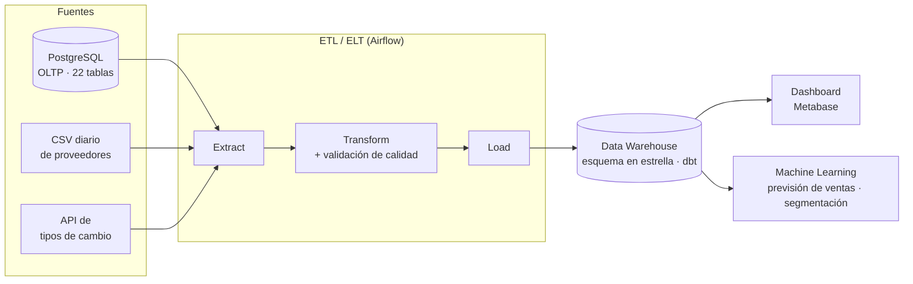

## Stack

| Área | Tecnología |
|---|---|
| Base de datos | PostgreSQL 17 |
| Infraestructura | Docker · Docker Compose |
| Generación de datos | Python · Faker · psycopg 3 |
| ETL | Python · pandas · openpyxl · requests · API REST |
| Orquestación | Apache Airflow 3.3 |
| Transformación | dbt 1.11 (dbt-postgres) |
| Visualización | Metabase 0.64 (LTS) |
| Machine Learning | scikit-learn · pandas · matplotlib |
| Calidad y CI | GitHub Actions · pytest · ruff |

---

## Vista rápida

| Dashboard de ventas (Metabase) | Machine Learning (Metabase) |
|---|---|
| 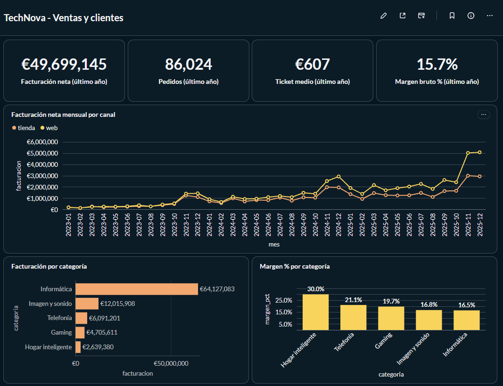 | 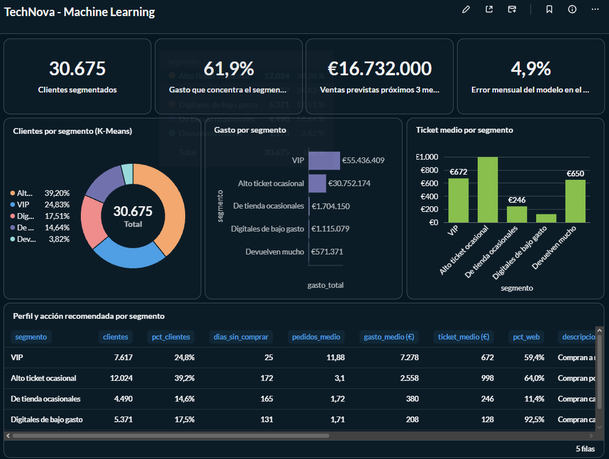 |
| **Orquestación con Airflow** | **Informe Excel generado automáticamente** |
| 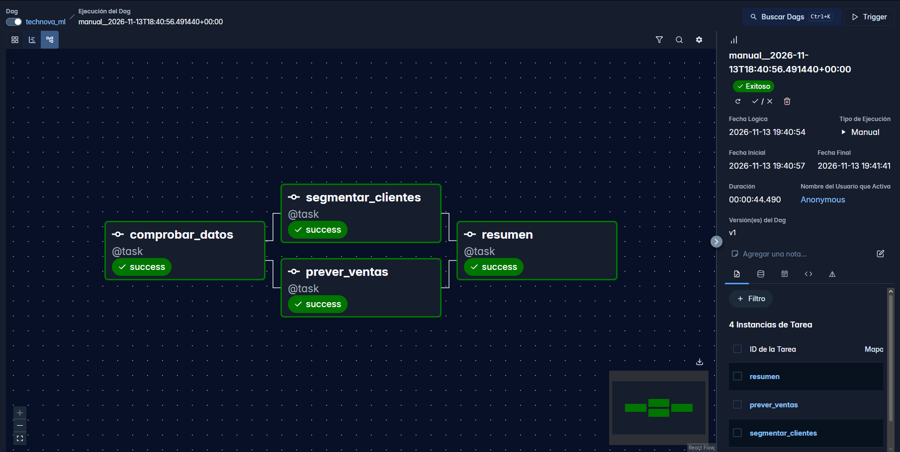 | 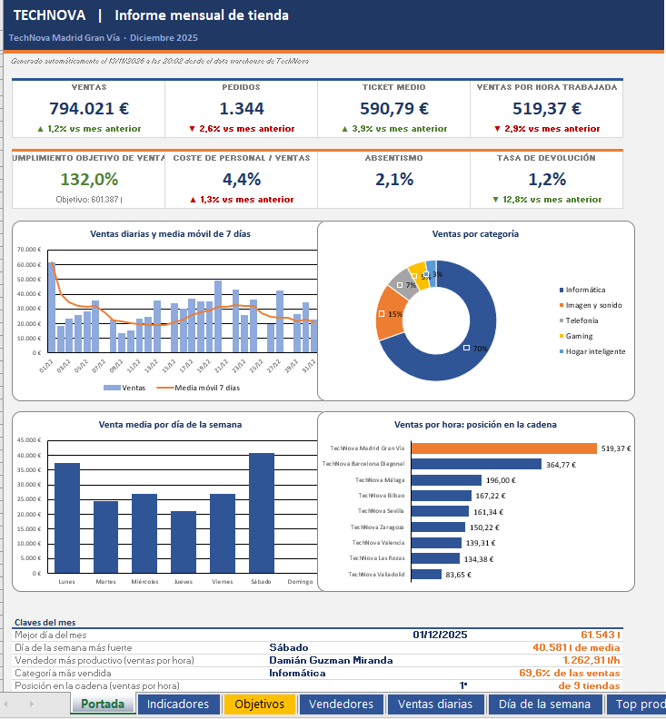 |

Cada sección incluye más capturas de su parte del proyecto.

---

## Modelo de datos (OLTP)

22 tablas en el esquema `oltp`, agrupadas en 7 áreas:

| Área | Tablas |
|---|---|
| Clientes | `cliente`, `direccion`, `nivel_fidelidad`, `ciudad` |
| Catálogo | `producto`, `categoria` (jerárquica), `marca` |
| Ubicaciones | `ubicacion` (tiendas y almacenes), `stock`, `empleado` (jerárquica) |
| Compras | `proveedor`, `pedido_compra`, `linea_compra` |
| Ventas | `pedido`, `linea_pedido`, `pago`, `envio` |
| Postventa | `devolucion`, `garantia` |
| Marketing | `promocion`, `promocion_producto`, `cupon` |

**Decisiones de diseño destacadas**

- **Precio histórico**: `linea_pedido.precio_unitario` guarda el precio del momento de la venta, independiente del precio actual del producto.
- **Reglas de negocio en la base de datos** mediante `CHECK`: una venta en tienda exige tienda y empleado; una venta web no puede tener empleado; el precio de venta nunca es inferior al coste…
- **Auto-relaciones** para la jerarquía de categorías y el organigrama de empleados.
- **Tiendas y almacenes en una sola tabla** `ubicacion` para que stock, empleados y compras apunten a una única entidad.
- **`NUMERIC`** para importes (nunca `FLOAT`) y claves `GENERATED ALWAYS AS IDENTITY`.

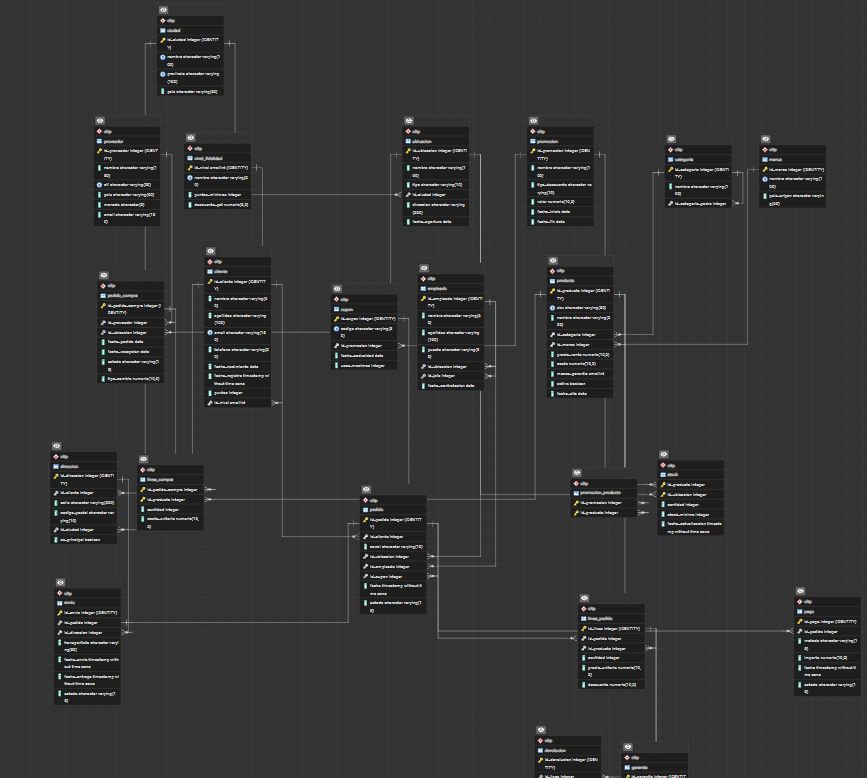
*Diagrama entidad-relación de las 22 tablas, generado con pgAdmin.*

---

## Generador de datos

Simulación **reproducible** (semilla fija) de 3 años de actividad (2023-2025), día a día:

| Dato | Volumen aprox. |
|---|---|
| Clientes / direcciones | 40.000 / 49.800 |
| Productos | 376 (20 marcas, 17 subcategorías) |
| Pedidos / líneas | 151.000 / 230.000 |
| Devoluciones / garantías | 11.900 / 840 |
| Pedidos a proveedores | 580 |
| Facturación anual (2025) | 52 millones de euros |

**Comportamientos realistas simulados**

- Crecimiento del negocio ligado al número de clientes registrados
- Estacionalidad: Black Friday, Cyber Monday, Navidad, rebajas, *Días sin IVA*, agosto flojo
- Tiendas cerradas en domingo y festivos; el canal web pasa del 45 % al 60 %
- Regla 80/20 en clientes (distribución de Pareto)
- Descuentos por promoción, cupón de bienvenida y nivel de fidelidad
- Pagos rechazados, pedidos cancelados y reembolsos
- Envíos desde el almacén más cercano, con retrasos en campañas y a Baleares
- Devoluciones dentro del plazo legal de 14 días (30 si es defectuoso) y garantía de 3 años
- Reposición mensual de stock con previsión, stock de seguridad y proveedores en USD, JPY y GBP

---

## SQL avanzado y optimización

### Índices

PostgreSQL crea índices para `PRIMARY KEY` y `UNIQUE`, pero no para las claves foráneas. `sql/init/02_indices.sql` define 28 índices:

| Tipo | Ejemplo | Para qué |
|---|---|---|
| Clave foránea | `idx_pedido_cliente` | JOIN y búsquedas por FK sin recorrer la tabla |
| Compuesto | `idx_pedido_cliente_fecha (id_cliente, fecha DESC)` | Filtro y `ORDER BY` resueltos con un solo índice |
| Parcial | `idx_devolucion_pendiente ... WHERE estado = 'solicitada'` | Índice diminuto para la cola de trabajo de atención al cliente |
| De expresión | `idx_cliente_email_lower (LOWER(email))` | Login sin distinguir mayúsculas |

Los índices redundantes se evitan aplicando la regla del prefijo izquierdo: si una PK o UNIQUE compuesta ya empieza por una FK, no se crea otro índice para ella.

### Benchmark

`benchmarks/benchmark_indices.py` mide 8 consultas típicas con y sin índices usando `EXPLAIN ANALYZE`. Los índices se eliminan dentro de una transacción que después se deshace, así que la base de datos no se modifica.

| Consulta | Sin índices | Con índices | Mejora |
|---|---:|---:|---:|
| Último pedido de 2.000 clientes (subconsulta correlacionada) | 7.462 ms | 2,4 ms | x3.151 |
| Login por email (sin mayúsculas) | 10,2 ms | < 0,01 ms | x2.045 |
| Líneas vendidas de un producto | 6,9 ms | < 0,01 ms | x1.732 |
| Pagos de un pedido | 4,8 ms | < 0,01 ms | x1.203 |

Resultados completos en [`docs/benchmark_indices.md`](docs/benchmark_indices.md).

### Capa de reporting

Esquema `reporting` (`sql/init/03_reporting.sql`) con vistas pensadas para análisis:

| Objeto | Tipo | Contenido |
|---|---|---|
| `v_lineas_venta` | Vista | Una fila por línea vendida con producto, categoría, marca, importes, margen y devoluciones |
| `v_ventas_mensuales` | Vista | KPIs por mes y canal: pedidos, facturación neta, margen, ticket medio |
| `v_alertas_stock` | Vista | Productos por debajo del stock mínimo, clasificados en ROTURA / CRÍTICO / BAJO |
| `mv_clientes_rfm` | Vista materializada | Segmentación RFM (Recency, Frequency, Monetary) con `NTILE` y 6 segmentos de cliente |

### Consultas de análisis

20 consultas de negocio en `sql/analisis/`, comentadas paso a paso:

| Fichero | Técnicas | Preguntas de negocio |
|---|---|---|
| `01_ventas.sql` | `LAG`, `SUM OVER`, medias móviles, `ROW_NUMBER`, `FILTER` | Crecimiento mes a mes y año a año, acumulado anual, top productos por categoría, rentabilidad del Black Friday, análisis de Pareto |
| `02_clientes.sql` | `NTILE`, cohortes, `PERCENTILE_CONT`, `LAG` por cliente | Regla 80/20, retención por cohortes, frecuencia de compra, clientes en riesgo |
| `03_operaciones.sql` | `RANK`, CTE recursiva, conversión de divisas | Ranking de vendedores, P90 de tiempos de entrega, tasa de devolución, gasto en proveedores en euros, organigrama |

### Hallazgos destacados

- **El Black Friday multiplica por 4 la facturación semanal, pero el margen cae a la mitad** (del 16,5 % al 8,5 % en 2025; en 2024 se quedó en un 1 %). Gana volumen y clientes nuevos a costa de rentabilidad.
- **El 20 % de los clientes genera el 65 % de la facturación** y el 10 % de mejores clientes, casi la mitad.
- **El 27 % del catálogo genera el 80 % de la facturación.**
- **En la web se devuelve más del doble que en tienda** (6,8 % frente a 3,1 % de las líneas).
- Un cliente tarda una mediana de 33 días en volver a comprar.

---

## ETL multi-fuente

`etl/` integra tres fuentes en una base de datos analítica separada (`technova_dw`), para que los informes nunca ralenticen la base de datos de la tienda.

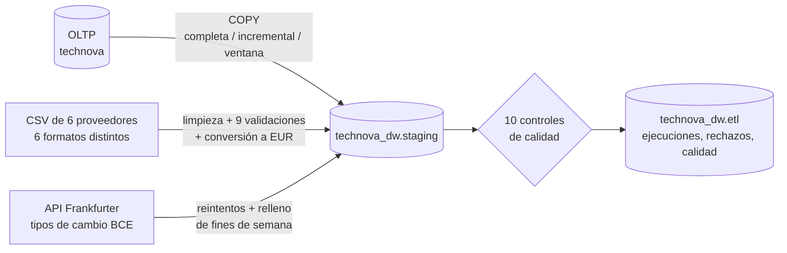

### Fuentes

| Fuente | Patrón | Detalles |
|---|---|---|
| OLTP (22 tablas) | ELT | `COPY` entre bases de datos. Tres estrategias de carga según la tabla (ver abajo) |
| API de tipos de cambio | ETL | Frankfurter v2 (datos oficiales del BCE). Carga incremental, reintentos con espera exponencial y gestión del `503 Retry-After`. Fines de semana y festivos se rellenan con el último valor publicado y se marcan como interpolados |
| CSV diarios de proveedores | ETL | Cada proveedor usa su propio separador, formato decimal, formato de fecha, codificación y nombres de columna. Un **contrato de datos** por proveedor los traduce al formato común |

### Estrategias de carga de la OLTP

| Estrategia | Cómo funciona | Tablas |
|---|---|---|
| Completa | `TRUNCATE` + `COPY` | Maestros, clientes, stock, envíos, compras |
| Incremental | Solo filas con id mayor que la marca de agua | `linea_pedido`, `pago` (solo se insertan, nunca se modifican) |
| Ventana | Filas de los últimos N días respecto a la marca de agua, con `UPSERT` | `pedido` (30 días), `devolucion` (60), `garantia` (120): sus filas recientes cambian de estado |

### Validación de los ficheros de proveedores

Los CSV se leen siempre como texto y cada fila se valida. Las filas rechazadas se guardan en `etl.rechazo` con el motivo y la fila original.

| Problema | Tratamiento |
|---|---|
| SKU en minúsculas o con espacios | Se corrige |
| SKU vacío o que no existe en el catálogo | Se rechaza |
| Precio vacío, con texto, negativo o cero | Se rechaza |
| Precio anómalo (fuera de 0,5x - 2x del coste conocido, p. ej. errores de tecleo x100) | Se rechaza |
| Stock vacío o negativo | Se rechaza |
| Fecha imposible o moneda distinta a la del contrato | Se rechaza |
| Sin tipo de cambio para esa fecha | Se rechaza |
| SKU duplicado en el fichero | Se conserva la última aparición |
| Más del 25 % de filas con errores | **Se descarta el fichero entero** (cortacircuitos) |

Cada fichero se registra con su hash SHA-256: no se procesa dos veces, pero si el proveedor reenvía una versión corregida con el mismo nombre, se detecta y se vuelve a cargar. Cada fichero se procesa en su propio `SAVEPOINT`, así que un fichero que falla no afecta a los demás.

### Controles de calidad

Tras la carga se ejecutan 10 controles. Los de severidad `error` hacen fallar la ejecución (código de salida 1), para que lo que va después no trabaje con datos incorrectos.

| Control | Severidad |
|---|---|
| Integridad referencial (líneas y pagos sin pedido) | error |
| Importes negativos o descuentos mayores que el importe | error |
| Stock negativo | error |
| Huecos en el calendario de tipos de cambio | error |
| Reconciliación de conteos OLTP / staging | error |
| Pedidos sin líneas | aviso |
| Tipos de cambio desactualizados | aviso |
| Proveedores sin tarifa del día | aviso |
| Tarifas que se desvían más de un 30 % del coste | aviso |

### Trazabilidad

| Tabla | Contenido |
|---|---|
| `etl.ejecucion` / `etl.paso` | Cada ejecución y cada paso: estado, duración, filas leídas, cargadas y rechazadas |
| `etl.watermark` | Hasta dónde se cargó cada tabla incremental |
| `etl.rechazo` | Cada fila rechazada con su motivo y los datos originales |
| `etl.fichero_procesado` | Ficheros procesados con su hash y su resultado |
| `etl.control_calidad` | Resultado de cada control en cada ejecución |

---

## Orquestación con Airflow

El ETL se ejecuta automáticamente cada noche con **Apache Airflow 3.3**, que corre en su propio contenedor junto a PostgreSQL y pgAdmin.

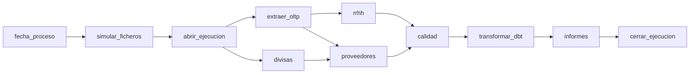

| Decisión | Motivo |
|---|---|
| Programado a las 03:00 (`0 3 * * *`), procesa el día anterior | El día ya está completo y no compite con las ventas |
| `extraer_oltp` y `divisas` en paralelo | No dependen la una de la otra |
| `proveedores` espera a las dos | Necesita el catálogo y los tipos de cambio |
| 2 reintentos con 2 minutos de espera | Absorbe fallos temporales (API caída, red) |
| `calidad` sin reintentos | Reintentar no arregla datos incorrectos |
| `transformar_dbt` después de `calidad` | dbt solo transforma datos que han pasado los controles |
| `informes` después de `transformar_dbt` | Los informes Excel se generan el último día de cada mes, con los datos ya transformados |
| `cerrar_ejecucion` con `trigger_rule=ALL_DONE` | Se ejecuta siempre y deja la ejecución cerrada en `etl.ejecucion` con su estado real |
| `max_active_runs=1` | Dos cargas a la vez podrían pisarse |
| Importaciones del ETL dentro de las tareas | Airflow lee el DAG cada pocos segundos; así esa lectura es instantánea |
| Parámetro `fecha` | Permite reprocesar un día concreto desde la web |

Cada tarea pasa el identificador de la ejecución a la siguiente mediante **XCom**, de modo que todos los pasos de una noche quedan agrupados en una sola fila de `etl.ejecucion`.

Un segundo DAG, `technova_ml`, reentrena los modelos de Machine Learning el día 1 de cada mes a las 05:00, cuando el ETL ya ha cargado el mes completo. Primero comprueba que el data warehouse está al día y después entrena la segmentación y la previsión en paralelo. Va en un DAG aparte porque tiene otro ritmo: los datos cambian cada día, pero reentrenar cada día no aporta nada.

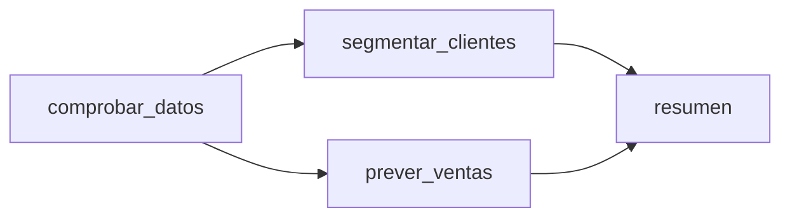

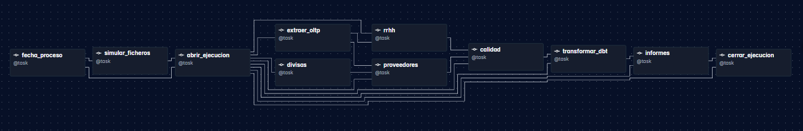
*Grafo de tareas del DAG `technova_etl`: `extraer_oltp` y `divisas` en paralelo, después proveedores y RRHH, controles de calidad, dbt, informes y cierre.*

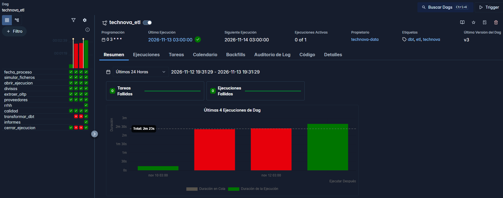
*Resumen de ejecuciones: dos noches fallaron en `transformar_dbt` (la imagen de Docker aún no tenía dbt instalado) y, una vez corregido, el pipeline volvió a terminar en verde. `cerrar_ejecucion` se ejecuta siempre y deja el estado real registrado.*


*DAG `technova_ml`: comprueba que el data warehouse está al día y entrena los dos modelos en paralelo.*

El DAG del ETL se ha probado con ejecuciones correctas, con un fallo de calidad forzado (stock negativo) y con la API de divisas caída: en los dos últimos casos las tareas dependientes no se ejecutan, la ejecución queda en `error` y el DAG en rojo.

---

## Data warehouse con dbt

`dbt/` transforma los datos de `staging` en un **esquema en estrella** dentro de `technova_dw`, con tests automáticos y documentación generada.

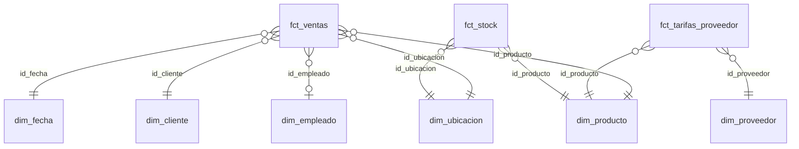

### Capas

| Capa | Esquema | Materialización | Modelos |
|---|---|---|---|
| Staging | `stg` | Vista | 20 modelos `stg_`: nombres limpios y tipos, uno por tabla de origen |
| Intermedia | `int` | Vista | `int_lineas_venta` (ventas con devoluciones), `int_clientes_rfm` (segmentación RFM) |
| Marts | `marts` | Tabla | 6 dimensiones y 4 tablas de hechos |
| Seeds | `seeds` | Tabla | `festivos_nacionales` (CSV de referencia) |
| Snapshots | `snapshots` | Tabla | `snp_clientes`: historial de niveles de fidelidad |

### Modelo en estrella

| Tabla | Grano | Contenido |
|---|---|---|
| `fct_ventas` | Línea de pedido | Cantidad, importe bruto y neto, descuento, coste, margen, devoluciones |
| `fct_pedidos` | Pedido | Totales, método de pago, pagos fallidos, transportista, horas hasta el envío, días hasta la entrega |
| `fct_tarifas_proveedor` | Proveedor, producto y día | Precio en moneda original y en euros, desviación respecto al coste, stock y plazo |
| `fct_stock` | Producto y ubicación | Cantidad, stock mínimo, nivel de alerta, valor del stock |
| `dim_fecha` | Día | Calendario con festivos nacionales, campañas de descuento activas y Black Friday |
| `dim_cliente` | Cliente | Ciudad, rango de edad, nivel de fidelidad y segmento RFM |
| `dim_producto` | Producto | Categoría, subcategoría, marca, margen y rango de precio |
| `dim_ubicacion`, `dim_empleado`, `dim_proveedor` | | Contexto de tiendas, vendedores y proveedores |

### Técnicas utilizadas

| Técnica | Dónde | Para qué |
|---|---|---|
| Modelo incremental | `fct_ventas` | Solo recalcula los últimos 60 días cada noche (unas 43.000 filas en vez de 225.000), suficiente para recoger devoluciones tardías |
| Snapshot (SCD tipo 2) | `snp_clientes` | Guarda cada cambio de nivel de un cliente con su `dbt_valid_from` y `dbt_valid_to`, para saber en qué nivel estaba en cualquier fecha |
| Seed | `festivos_nacionales` | Datos de referencia versionados en Git |
| Calendario generado con SQL | `dim_fecha` | `generate_series` más festivos y campañas |
| Macro de esquemas | `generate_schema_name` | Esquemas con nombres limpios (`stg`, `int`, `marts`) |
| Variables | `dbt_project.yml` | Rango del calendario y días de reproceso configurables |

### Tests

56 tests que se ejecutan en cada `dbt build`:

| Tipo | Ejemplos |
|---|---|
| Genéricos de dbt | `unique` y `not_null` en todas las claves, `relationships` de cada hecho con sus dimensiones, `accepted_values` en canales, segmentos y niveles de alerta |
| Genéricos propios (macros) | `no_negativo` (importes, márgenes, stock), `unique_combinacion` (claves de varias columnas) |
| Singulares | `assert_ventas_cuadran_con_staging` (reconciliación de importes) y `assert_devuelto_no_supera_vendido` |

dbt se ejecuta como último paso del ETL y como tarea de Airflow, **solo si los controles de calidad han ido bien**: si un test falla, la ejecución queda en `error` con el nombre del test en `etl.paso`.

### Documentación

```bash
python etl/transformar_dbt.py docs generate
python etl/transformar_dbt.py docs serve --port 8081
```

Genera una web con la descripción de cada modelo y columna y el gráfico de linaje (de qué tabla sale cada tabla).

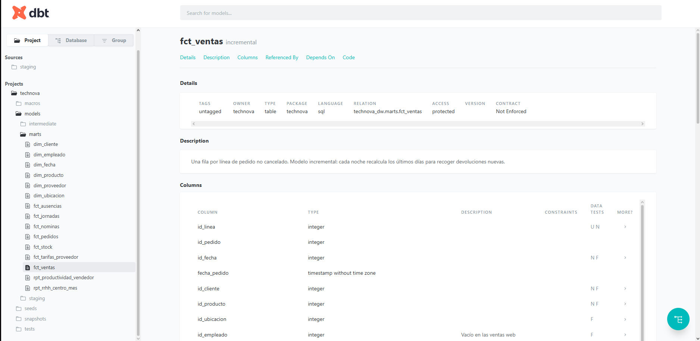
*Ficha de un modelo en la documentación: descripción, columnas, tests y SQL.*

---

## Dashboards con Metabase

Cuatro dashboards en **Metabase** (herramienta de BI de código abierto) que leen directamente el esquema en estrella. Se crean **desde código**: están definidos en `dashboard/dashboards.py` y `dashboard/crear_dashboard.py` los construye a través de la API de Metabase, así que cualquiera que clone el repositorio obtiene exactamente los mismos dashboards con un comando.

### TechNova - Ventas y clientes

| Gráfico | Tipo |
|---|---|
| Facturación neta, pedidos, ticket medio y margen bruto del último año | Indicadores |
| Facturación neta mensual por canal (web y tienda) | Líneas |
| Facturación y margen por categoría | Barras |
| Black Friday: facturación y margen % de la Black Week frente a la semana anterior | Barras |
| Pedidos por día de la semana y canal | Barras |
| Clientes y facturación por segmento RFM | Tarta y barras |
| Clientes por rango de edad | Barras |
| Top 10 productos por facturación | Tabla |


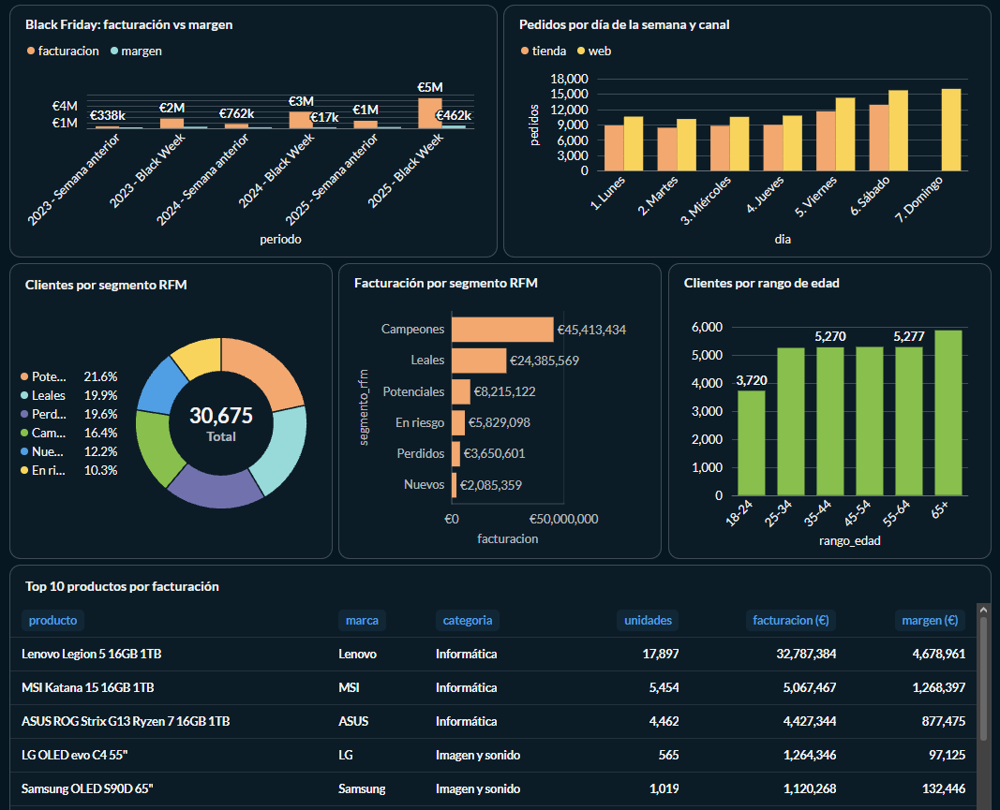

### TechNova - Operaciones

| Gráfico | Tipo |
|---|---|
| Valor del stock, productos en rotura, tasa de devolución y envíos en 3 días o menos | Indicadores |
| Días hasta la entrega por transportista (media y percentil 90) | Barras |
| Tasa de devolución por subcategoría | Barras |
| Alertas de stock en almacenes | Tabla |
| Desviación diaria de las tarifas de cada proveedor | Líneas |
| Últimas ejecuciones del ETL y filas rechazadas por motivo | Tabla y barras |

La última fila convierte el dashboard en un **monitor del propio pipeline**: muestra cuándo se ejecutó el ETL, cuánto tardó y qué rechazó.

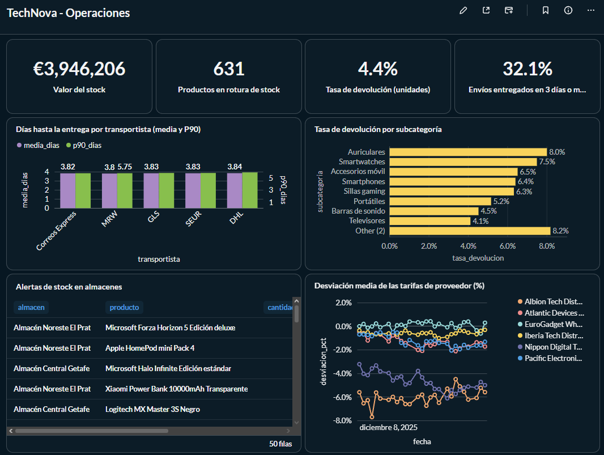
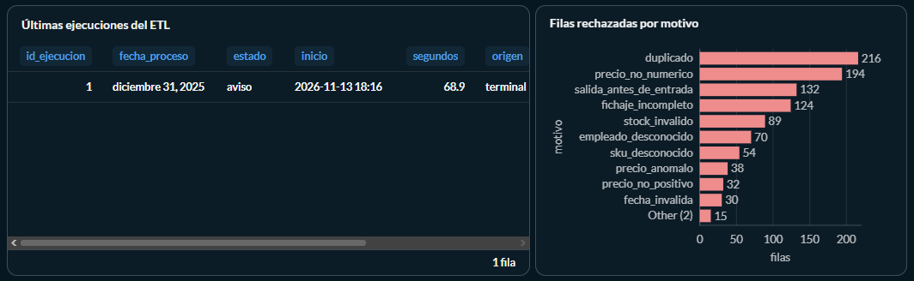

### TechNova - Recursos Humanos

Plantilla, horas extra, absentismo y coste de personal del último mes, su evolución, el absentismo por centro, las ventas por hora trabajada de cada tienda y el top 10 de vendedores (se explica en [Excel de Recursos Humanos](#excel-de-recursos-humanos)).

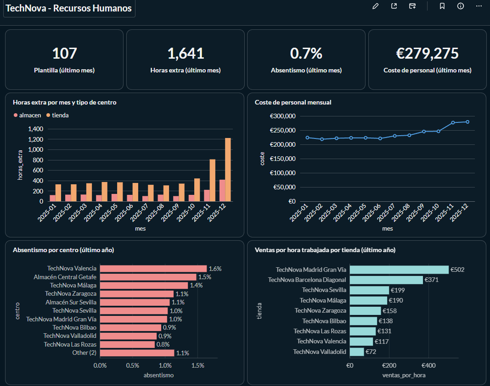
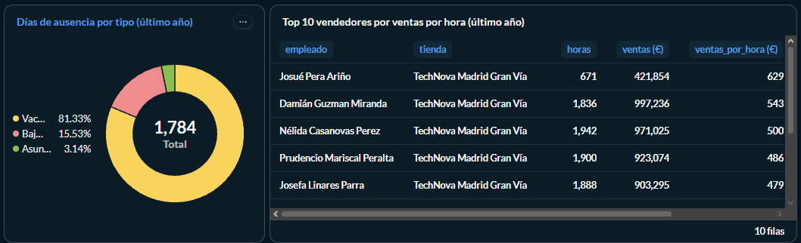

El script es idempotente: si se vuelve a ejecutar, actualiza los gráficos existentes en vez de duplicarlos. Busca los objetos listando la colección `TechNova` y no con el buscador de Metabase, que se indexa en segundo plano.

---

## Excel de Recursos Humanos

Cada mes llegan a RRHH tres tipos de Excel **hechos a mano**, con los problemas típicos de los Excel reales. `etl/excel_rrhh.py` los lee, limpia, valida y carga, y dbt los cruza con las ventas.

| Excel | Quién lo envía | Problemas que resuelve el ETL |
|---|---|---|
| `fichajes_<centro>_<mes>.xlsx` | El encargado de cada centro | Título y celdas combinadas antes de la cabecera, filas en blanco entre semanas, fila de TOTAL, fechas y horas escritas como texto (`9:58`, `09.58`, `9h58`), columna de horas que es una fórmula sin valor, empleados sin número (se identifican por el nombre, sin importar tildes ni mayúsculas) |
| `ausencias_<mes>.xlsx` | RRHH | Una hoja por centro con el nombre recortado a 31 caracteres, solo el nombre del empleado, el tipo escrito de muchas formas (`Vacaciones`, `VAC`, `IT`, `Baja`...) |
| `nominas_<mes>.xlsx` | La gestoría | Cabecera en la fila 7 tras el membrete, `Apellidos, Nombre`, importes como texto (`1.850,00 €`), fila de TOTALES con fórmulas |

**Técnicas**

| Técnica | Para qué |
|---|---|
| Búsqueda de la fila de cabecera | No se da por hecho que los datos empiecen en la fila 1 |
| Recalcular en vez de leer fórmulas | Las horas se calculan a partir de entrada, salida y pausa; no se confía en la fórmula del Excel |
| Validaciones por fila | Salida antes que la entrada, fichaje sin salida, empleado desconocido o ambiguo, fechas invertidas, importes que no cuadran (base + plus + horas extra = devengado) |
| Carga por partición | Cada Excel sustituye por completo los datos de su centro y mes. Si llega un Excel corregido con filas borradas, esas filas desaparecen (un `UPSERT` las dejaría) |
| Hash de cada fichero | Igual que con los CSV: no se procesa dos veces, pero se detecta un reenvío corregido |

**Modelos de dbt**

| Modelo | Contenido |
|---|---|
| `fct_jornadas` | Una fila por empleado y día trabajado, con horas ordinarias y extra |
| `fct_ausencias` | Los periodos de ausencia desplegados en días laborables (si se solapan, cuenta uno por día con prioridad para la baja médica) |
| `fct_nominas` | Una fila por empleado y mes |
| `rpt_productividad_vendedor` | Ventas por hora trabajada y por euro de coste de cada vendedor: cruza ventas (base de datos), horas (Excel de fichajes) y coste (Excel de nóminas) |
| `rpt_rrhh_centro_mes` | Plantilla, horas, horas extra, absentismo y coste de personal frente a ventas por centro y mes |

Un test de dbt con severidad `warn` compara las horas extra que paga la gestoría con las fichadas, y avisa cuando no cuadran.

En Airflow, la tarea `rrhh` se ejecuta en paralelo con proveedores, y los Excel de cada mes llegan el último día del mes.

---

## Informes automáticos en Excel

El camino contrario: `etl/informes_excel.py` genera cada fin de mes **informes en Excel listos para enviar**, a partir del data warehouse. Son 10 ficheros en `informes/<AAAA-MM>/`. El aspecto (colores, tarjetas, tablas, gráficos, impresión) está separado en `etl/excel_estilos.py`.

### Informe de tienda (uno por tienda, para su encargado)

| Hoja | Contenido |
|---|---|
| Portada | Cuadro de mando: 8 tarjetas de indicadores con su variación frente al mes anterior (flecha verde o roja según sea buena o mala), 4 gráficos y las "claves del mes" |
| Indicadores | 12 indicadores frente al mes anterior, al mismo mes del año pasado y al objetivo, con semáforo de cumplimiento |
| Objetivos | Objetivos y parámetros **editables** (celdas amarillas, con validación de datos y hoja protegida). Se proponen a partir del mismo mes del año anterior |
| Vendedores | Ranking, podio resaltado, barras de datos y retribución variable (comisión y bonus) calculada con los parámetros de la hoja Objetivos |
| Ventas diarias | Media móvil de 7 días, acumulado del mes y ritmo frente al objetivo; fines de semana sombreados |
| Día de la semana | Venta media por día de la semana con `SUMIFS` y `COUNTIFS` sobre las ventas diarias |
| Top productos | Los 10 más vendidos y gráfico de Pareto (barras más % acumulado en un segundo eje) |
| Comparativa tiendas | La tienda frente al resto de la cadena, resaltada en la tabla y en el gráfico |


*Portada: tarjetas de indicadores con su variación, gráficos y claves del mes.*

| Indicadores con semáforo de cumplimiento | Vendedores con comisiones y podio |
|---|---|
| 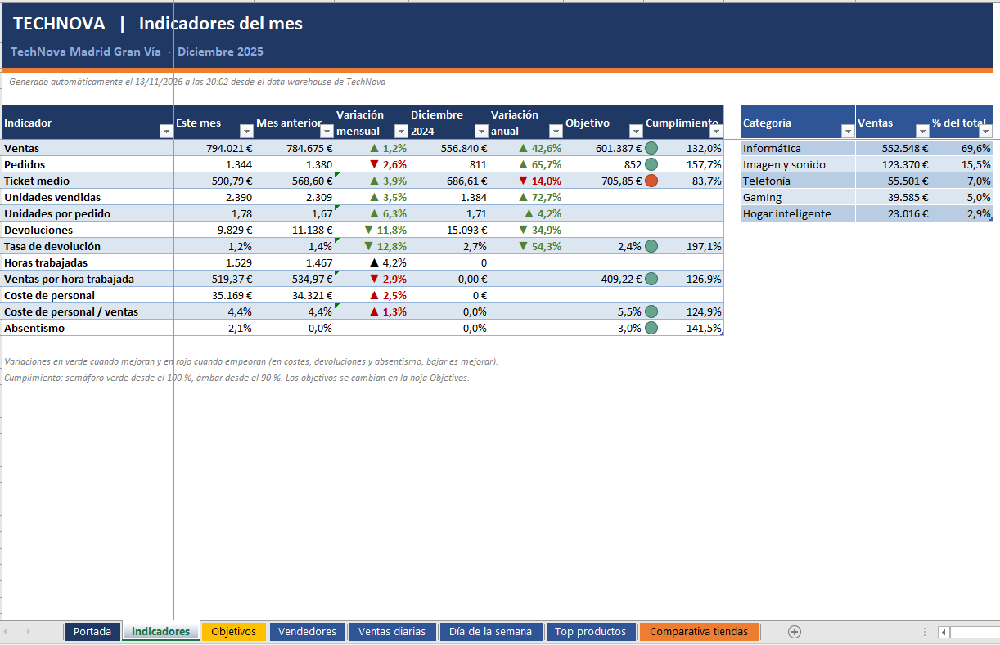 | 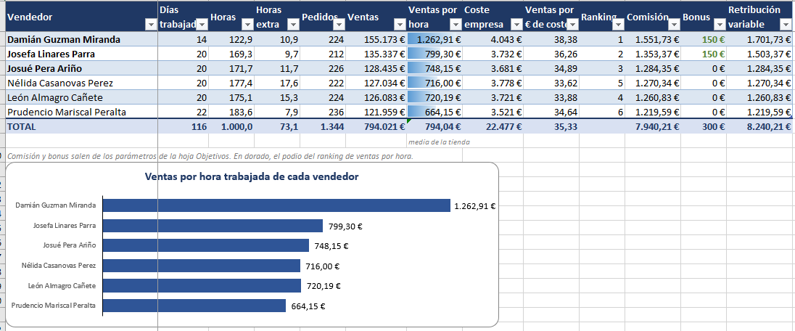 |

### Informe de Recursos Humanos

| Hoja | Contenido |
|---|---|
| Portada | Cuadro de mando de toda la empresa con variaciones, evolución y ausencias por tipo |
| Centros | Indicadores por centro con alerta según un umbral de absentismo editable |
| Ficha de centro | **Hoja interactiva**: se elige un centro en un desplegable y las tarjetas, la tabla de 12 meses y los gráficos se recalculan |
| Horas extra | Conciliación de horas fichadas por precio pactado frente a lo pagado en nómina, con el estado de cada empleado |
| Ausencias | Detalle del mes y matriz centro por tipo de ausencia hecha con `SUMIFS` |
| Evolución | Últimos 12 meses, calculados con fórmulas sobre la hoja Datos |
| Parámetros y Datos | Umbrales y precios editables, y los datos de origen con nombres definidos (`DatosMes`, `DatosCentro`...) |

| Ficha de centro con selector desplegable | Conciliación de horas extra con la nómina |
|---|---|
| 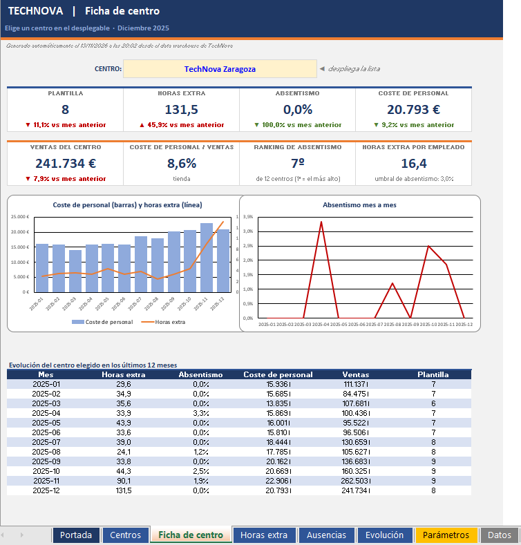 | 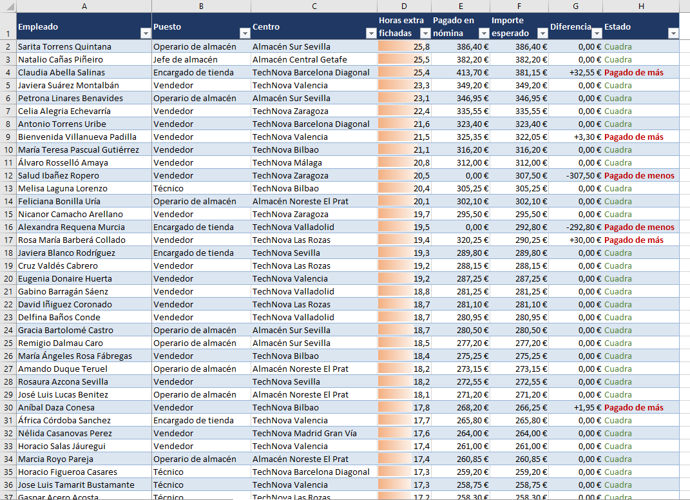 |

Todo lo derivado (ticket medio, variaciones, cumplimientos, comisiones, acumulados, rankings, matrices y totales) se escribe como **fórmulas de Excel**, no como números: si alguien cambia un objetivo, un parámetro o un dato, el libro entero se recalcula. Técnicas usadas: `SUMIFS`, `COUNTIFS`, `INDEX`/`MATCH`, `RANK`, `EOMONTH`, nombres definidos, validación de datos con lista desplegable, formato condicional (escalas de color, barras de datos, iconos de semáforo y reglas con fórmula), gráficos combinados con eje secundario, protección de hoja y configuración de impresión. Se ha comprobado con LibreOffice que ninguna fórmula de los 10 informes da error y que la hoja interactiva y los objetivos editables recalculan correctamente.

Además, un tercer dashboard en Metabase, **TechNova - Recursos Humanos**, muestra plantilla, horas extra, absentismo y coste de personal del último mes, su evolución, el absentismo por centro, las ventas por hora trabajada de cada tienda y el top 10 de vendedores.

---

## Machine Learning

Dos modelos con **scikit-learn** que leen del esquema en estrella y escriben sus resultados en el esquema `ml` del data warehouse, para que Metabase y cualquier consulta SQL puedan usarlos. Se reentrenan solos una vez al mes con el DAG `technova_ml`, y cada entrenamiento queda registrado en `ml.ejecucion` con sus parámetros y métricas.

### Segmentación de clientes con K-Means

La segmentación RFM de dbt usa **reglas escritas a mano** ("si R >= 4 y F >= 4 y M >= 4, Campeones"). Aquí es al revés: el algoritmo recibe 6 características de cada cliente y encuentra solo los grupos de clientes parecidos (aprendizaje **no supervisado**).

| Paso | Detalle |
|---|---|
| Variables | Días sin comprar, pedidos, gasto neto, ticket medio, % de pedidos en la web y tasa de devolución |
| Preparación | Logaritmo en las variables muy asimétricas y estandarización (`ColumnTransformer` + `StandardScaler`): K-Means mide distancias y, sin escalar, el gasto en euros aplastaría al resto |
| Elección de k | Método del codo y coeficiente de silueta para k de 2 a 9, eligiendo entre 4 y 6 (menos grupos no sirven para marketing y más son difíciles de manejar) |
| Nombres | Cada grupo recibe un nombre según lo que más destaca de su centroide, con una descripción y una acción recomendada |
| Salida | `ml.segmento_cliente` (un segmento por cliente), `ml.segmento_resumen` y el modelo en `models/segmentacion_kmeans.joblib` |

Resultado con los datos del generador: **30.675 clientes con compras en 5 segmentos** (silueta 0,24).

| Segmento | Clientes | % de los clientes | % del gasto |
|---|---:|---:|---:|
| VIP | 7.617 | 24,8 % | 61,9 % |
| Alto ticket ocasional | 12.024 | 39,2 % | 34,3 % |
| De tienda ocasionales | 4.490 | 14,6 % | 1,9 % |
| Digitales de bajo gasto | 5.371 | 17,5 % | 1,2 % |
| Devuelven mucho | 1.173 | 3,8 % | 0,6 % |

El perfil completo de cada segmento (días sin comprar, pedidos, ticket medio, % web y devoluciones) está en el mapa de calor de abajo y en el dashboard de Machine Learning.

La cuarta parte de los clientes genera el 62 % del gasto. Además, K-Means encuentra grupos que las reglas RFM no pueden ver, porque RFM no mira el canal ni las devoluciones: los clientes que devuelven mucho o los que solo compran en la web.

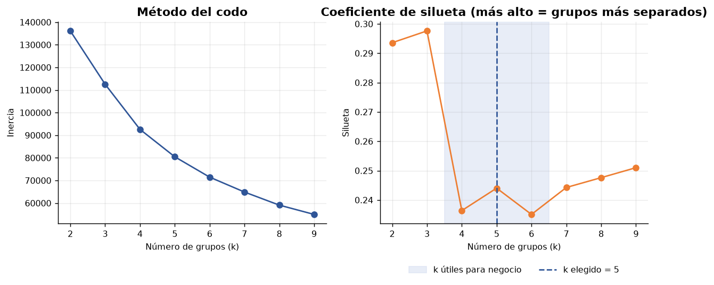
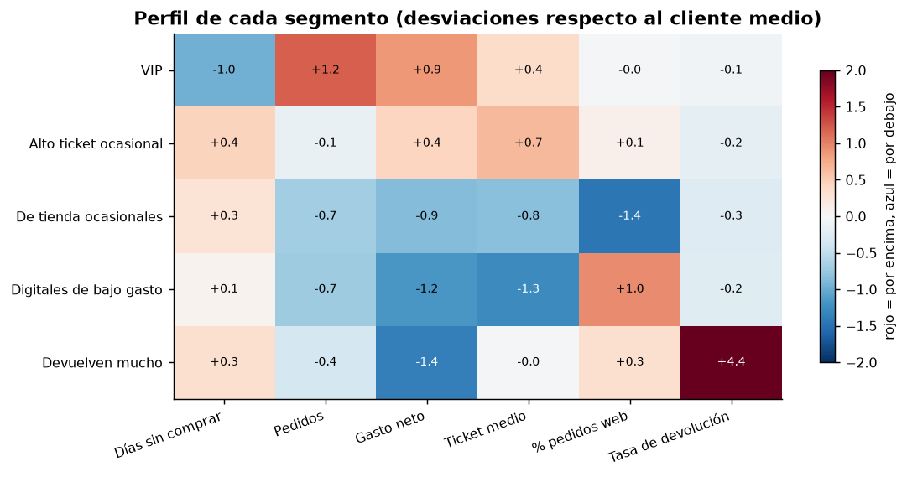
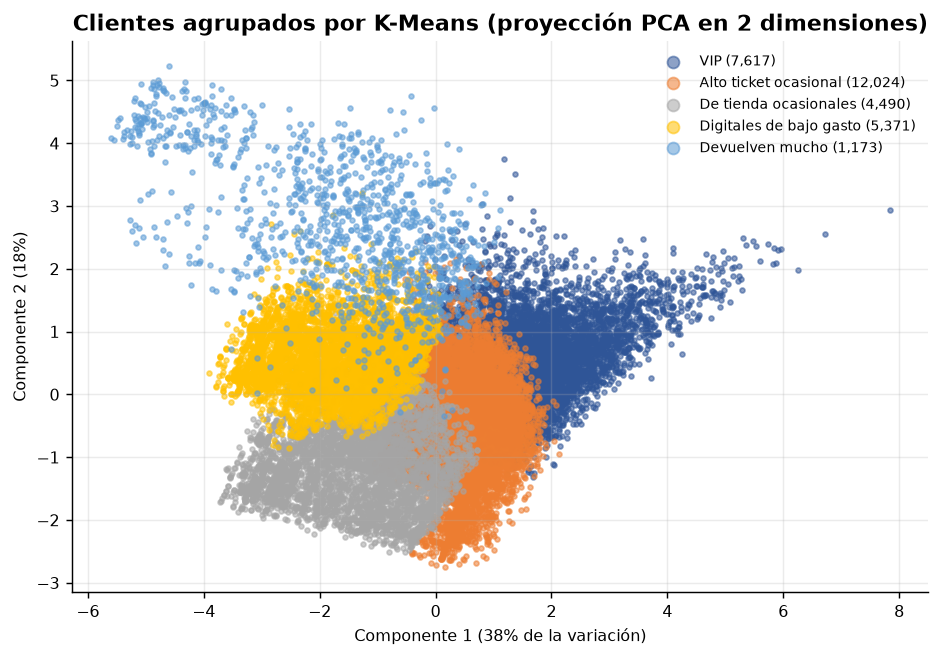

### Previsión de ventas

Aprendizaje **supervisado** (regresión): prevé las ventas diarias de los próximos 3 meses para la web y para las tiendas.

La clave es **no hacer trampas con el tiempo**. Para prever un día que está a 92 días vista solo se puede usar lo que se sabía 92 días antes. Por eso el "nivel" de ventas de cada día es la media de los 28 días que terminan 92 días antes, y el modelo aprende el cociente entre las ventas del día y ese nivel. Así, además, el modelo no tiene que extrapolar el crecimiento de la empresa, algo que los árboles de decisión no saben hacer.

La validación es **temporal y en tres tramos**, para no elegir nada mirando el periodo con el que se evalúa:

```
|---------------- entrenamiento ----------------|-- validación --|-- test (backtest) --|
                                                   jul-sep 2025      oct-dic 2025
```

- En la **validación** se elige cuánto pesan los días recientes (la vida media de los pesos: 365, 180, 90 o 45 días, o todos igual). TechNova crece cada vez más despacio (x4,8 en 2023, x1,8 en 2025), y lo de hace dos años se parece poco a lo de ahora: con pesos de 90 días de vida media, el error del Gradient Boosting baja casi a la mitad.
- En el **test** se comparan 4 modelos con lo que pasó de verdad y se elige el mejor para cada canal.

| Modelo | Cómo prevé |
|---|---|
| `media_4_semanas` | Media de los 4 últimos días iguales (lunes con lunes). Modelo ingenuo |
| `anio_anterior` | El mismo día del año pasado por el crecimiento de los últimos 3 meses. Modelo ingenuo |
| `gradient_boosting` | `HistGradientBoostingRegressor` con día de la semana, mes, día del mes, festivos (seed de dbt), distancia al Black Friday y a Navidad |
| `combinado` | Media de los dos anteriores (*ensemble*: sus errores se compensan) |

| Canal | Modelo | Error diario (WAPE) | Error mensual | Sesgo |
|---|---|---:|---:|---:|
| Web | **combinado** (elegido) | 15,5 % | 6,2 % | +2,6 % |
| Web | gradient_boosting | 16,2 % | 8,4 % | +5,6 % |
| Web | anio_anterior | 18,0 % | 4,1 % | -0,4 % |
| Web | media_4_semanas | 39,7 % | 34,9 % | -33,2 % |
| Tienda | **combinado** (elegido) | 19,0 % | 3,5 % | -0,7 % |
| Tienda | gradient_boosting | 19,3 % | 3,8 % | +3,0 % |
| Tienda | anio_anterior | 21,2 % | 4,4 % | -4,3 % |
| Tienda | media_4_semanas | 38,2 % | 30,5 % | -32,9 % |

Para cada canal se elige el modelo con menor error diario (WAPE). En los dos canales gana el **combinado**: el Gradient Boosting acierta mejor el día a día (festivos, Black Friday, día de la semana) y el modelo del año anterior corrige su tendencia a pasarse, así que la media de los dos es mejor que cada uno por separado. En el total de cada mes, el error del modelo elegido es del 6 % en la web y del 3,5 % en las tiendas. Cada previsión lleva un **intervalo del 80 %**, calculado a partir de los errores del backtest.

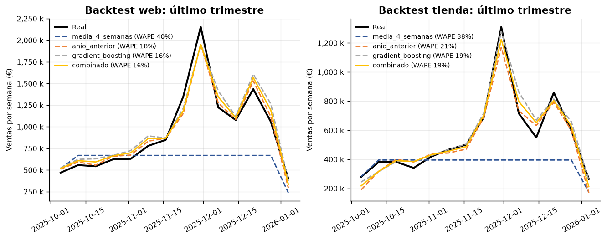
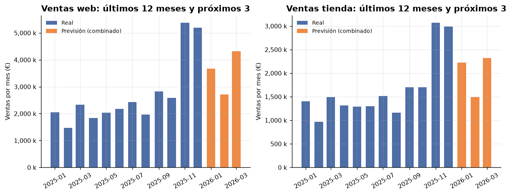
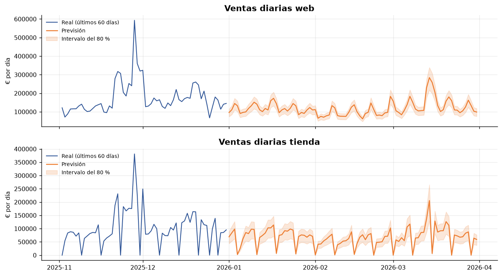

### Dashboard TechNova - Machine Learning

Un cuarto dashboard en Metabase muestra los segmentos (tamaño, gasto, ticket, perfil y acción recomendada), la comparación de K-Means con los segmentos RFM, la previsión mensual y diaria con su intervalo, el backtest y la comparativa de modelos.


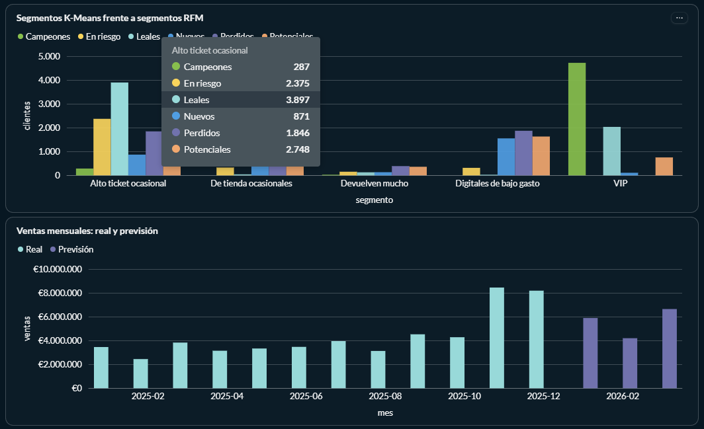
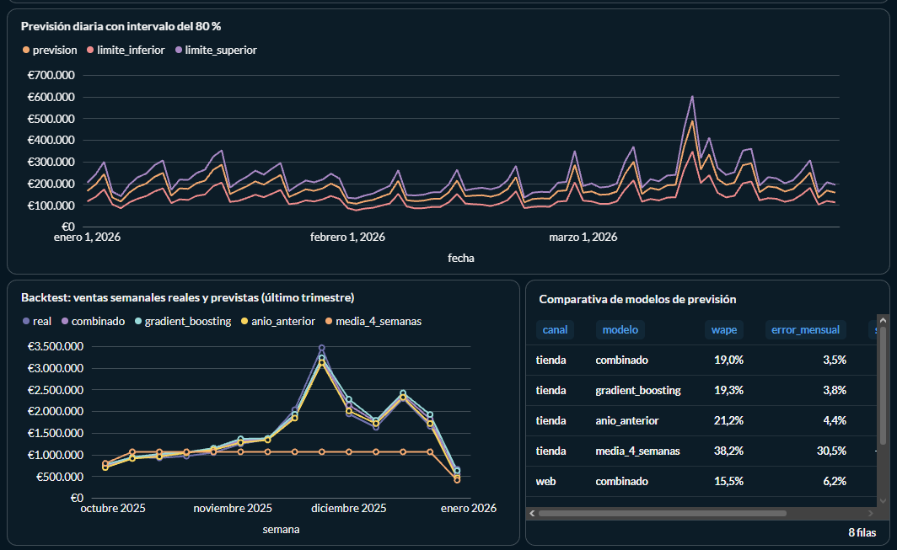

---

## Integración continua (CI)

Cada `git push` lanza en **GitHub Actions** (`.github/workflows/ci.yml`) dos trabajos. Si alguno falla, el commit queda marcado en rojo y la insignia del principio de este README lo muestra.

| Trabajo | Qué hace | Tiempo |
|---|---|---|
| **Calidad de código y tests** | `ruff` revisa el estilo y los errores (variables sin usar, imports que faltan...) y `pytest` ejecuta 67 tests unitarios | ~1 min |
| **Pipeline de punta a punta** | Levanta un PostgreSQL 17 real, genera una TechNova de 3.000 clientes y ejecuta el proyecto **entero**: generador, ETL con la API de divisas real, `dbt build` con sus 69 tests, informes Excel y los dos modelos de ML. Después `scripts/comprobar_pipeline.py` verifica 14 resultados, entre ellos que las ventas del data warehouse cuadren al céntimo con las de la OLTP | ~4 min |

Los tests unitarios (`tests/`) cubren las partes con más lógica:

| Fichero | Qué comprueba |
|---|---|
| `test_excel_rrhh.py` | Fechas, horas e importes escritos de muchas formas (`9h58`, `09.58`, `1.850,00 €`, nº de serie de Excel...) y los rechazos con su motivo |
| `test_proveedores.py` | Cada error de un CSV de proveedor se rechaza con su motivo, los duplicados se quedan con la última aparición y la conversión a euros usa el tipo de cambio del día |
| `test_divisas.py` | Los fines de semana se rellenan con el viernes y se marcan como interpolados |
| `test_ml.py` | Nombres de los segmentos, Black Friday, métricas, pesos por recencia y un backtest completo con datos sintéticos |
| `test_informes.py` | Utilidades de fechas y nombres de los informes Excel |

Los informes Excel, los gráficos de ML y los logs generados en el CI se guardan como **artefactos** descargables de cada ejecución durante 7 días.

```bash
# Lo mismo en local
pip install -r requirements-dev.txt
ruff check .
pytest
python scripts/comprobar_pipeline.py     # después de reiniciar_todo.py
```

---

## Puesta en marcha

**Requisitos:** Docker Desktop (con al menos 6 GB de memoria asignada para tener todo encendido a la vez) y Python 3.10+

```bash
# 1. Clonar y configurar
git clone https://github.com/BongoDeveloper26/TechNova.git
cd TechNova
cp .env.example .env            # y edita las contraseñas

# 2. Levantar PostgreSQL, pgAdmin, Airflow y Metabase
docker compose up -d --build

# 3. Entorno virtual de Python
python -m venv .venv
source .venv/bin/activate       # Windows: .venv\Scripts\activate
pip install -r requirements.txt

# 4. Generarlo todo desde cero con un solo comando (unos 2 minutos):
#    datos simulados, ficheros de proveedores y RRHH, ETL + dbt, informes Excel y modelos de ML
python scripts/reiniciar_todo.py --si

# 5. Crear los dashboards en Metabase
python dashboard/crear_dashboard.py
```

Cada paso de `reiniciar_todo.py` también se puede lanzar por separado:

| Paso | Comando |
|---|---|
| Generar los datos | `python data_generator/main.py` |
| Simular los ficheros externos | `python etl/simular_proveedores.py --desde 2025-12-01 --hasta 2025-12-31` y `python etl/simular_rrhh.py --desde 2025-01 --hasta 2025-12` |
| ETL completo (incluye dbt) | `python etl/run_etl.py --fecha 2025-12-31` |
| Informes Excel de un mes | `python etl/informes_excel.py --mes 2025-12` |
| Modelos de Machine Learning | `python ml/segmentacion_clientes.py` y `python ml/prevision_ventas.py` |
| Benchmark de índices (opcional, unos 2 minutos) | `python benchmarks/benchmark_indices.py` |
| Documentación de dbt en http://localhost:8081 (opcional) | `python etl/transformar_dbt.py docs generate` y `python etl/transformar_dbt.py docs serve --port 8081` |

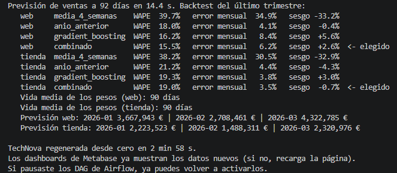
*Final de la salida de `reiniciar_todo.py`: todo el proyecto regenerado desde cero.*

Para cambiar el tamaño de la simulación basta con editar `NUM_CLIENTES` en `data_generator/config.py` y volver a ejecutar `reiniciar_todo.py`.

El contenedor de Airflow ejecuta el ETL automáticamente cada noche. La primera vez tarda unos minutos en construir su imagen. Al entrar en la web, hay que activar los DAG `technova_etl` y `technova_ml` (los DAG nuevos empiezan en pausa).

| Servicio | URL |
|---|---|
| PostgreSQL | `localhost:5432` |
| pgAdmin | http://localhost:5050 |
| Airflow | http://localhost:8080 |
| Metabase | http://localhost:3000 |

---

## Estructura

```
technova-data-platform/
├── docker-compose.yml          # PostgreSQL, pgAdmin, Airflow y Metabase
├── requirements.txt            # librerías de Python para ejecutar en local
├── requirements-dev.txt        # herramientas de desarrollo: ruff y pytest
├── pyproject.toml              # configuración de ruff y pytest
├── .env.example                # plantilla de las variables de entorno
├── .github/
│   └── workflows/
│       └── ci.yml              # CI: calidad de código, tests y pipeline de punta a punta
├── tests/                      # 67 tests unitarios con pytest
├── scripts/
│   ├── reiniciar_todo.py       # borra todo y lo regenera desde cero con un comando
│   └── comprobar_pipeline.py   # verifica que todo el pipeline ha dejado sus resultados
├── airflow/
│   ├── Dockerfile              # imagen oficial + librerías del ETL
│   ├── requirements-airflow.txt
│   ├── arrancar.sh             # crea la base de datos de Airflow y lo arranca
│   └── dags/
│       ├── technova_etl.py     # DAG diario del ETL
│       └── technova_ml.py      # DAG mensual de Machine Learning
├── sql/
│   ├── init/                   # se ejecutan solos al crear la base de datos OLTP
│   │   ├── 01_schema.sql       # esquema OLTP (22 tablas)
│   │   ├── 02_indices.sql      # 28 índices
│   │   └── 03_reporting.sql    # vistas de negocio y RFM
│   ├── analisis/               # consultas de análisis
│   │   ├── 01_ventas.sql
│   │   ├── 02_clientes.sql
│   │   └── 03_operaciones.sql
│   └── dw/
│       ├── 01_dw_schema.sql    # esquemas staging y etl del DW
│       └── 02_ml_schema.sql    # esquema ml (resultados de los modelos)
├── data_generator/             # simulación de datos
│   ├── main.py                 # ejecuta todo en orden
│   ├── config.py               # parámetros de la simulación
│   ├── db.py                   # conexión reutilizable
│   ├── seed_maestros.py
│   ├── seed_entidades.py
│   ├── seed_ventas.py
│   ├── seed_postventa.py
│   └── seed_inventario.py
├── etl/
│   ├── run_etl.py              # orquesta los pasos del ETL
│   ├── configuracion.py        # estrategias de carga, contratos de proveedor, umbrales
│   ├── conexiones.py           # OLTP y DW
│   ├── registro.py             # logs y trazabilidad en etl.*
│   ├── extraer_oltp.py         # OLTP -> staging
│   ├── divisas.py              # API -> staging
│   ├── proveedores.py          # CSV -> staging
│   ├── excel_rrhh.py           # Excel de RRHH -> staging
│   ├── informes_excel.py       # data warehouse -> informes Excel
│   ├── excel_estilos.py        # estilos, tarjetas y gráficos de los informes Excel
│   ├── calidad.py              # controles de calidad
│   ├── transformar_dbt.py      # lanza dbt y resume sus resultados
│   ├── simular_proveedores.py  # genera los CSV (simula el exterior)
│   └── simular_rrhh.py         # genera los Excel de RRHH (simula el exterior)
├── ml/
│   ├── comun.py                # conexión, registro de entrenamientos y gráficos
│   ├── segmentacion_clientes.py # K-Means
│   └── prevision_ventas.py     # backtest de 4 modelos y previsión a 3 meses
├── dashboard/
│   ├── dashboards.py           # definición de los 4 dashboards y sus 47 gráficos
│   └── crear_dashboard.py      # los crea en Metabase con su API
├── benchmarks/
│   └── benchmark_indices.py
├── dbt/
│   ├── dbt_project.yml
│   ├── profiles.yml            # conexión (lee las variables de entorno)
│   ├── models/
│   │   ├── staging/            # 20 modelos stg_ + fuentes
│   │   ├── intermediate/       # int_lineas_venta, int_clientes_rfm
│   │   └── marts/              # dim_ y fct_ + tests y documentación
│   ├── snapshots/              # snp_clientes (SCD tipo 2)
│   ├── seeds/                  # festivos_nacionales.csv
│   ├── macros/                 # nombres de esquema y tests propios
│   └── tests/                  # tests singulares
├── data/                       # ficheros de proveedores (no se sube a Git)
├── logs/                       # logs del ETL (no se sube a Git)
├── informes/                   # informes Excel generados (no se sube a Git)
├── models/                     # modelos entrenados .joblib (no se sube a Git)
└── docs/
    ├── benchmark_indices.md
    ├── img/                    # capturas del README
    └── ml/                     # gráficos de los modelos
```

---

## Roadmap

- [x] **Fase 1** — Modelo de datos y PostgreSQL en Docker
- [x] **Fase 2** — Generador de datos realistas
- [x] **Fase 3** — SQL avanzado, índices y optimización
- [x] **Fase 4a** — ETL multi-fuente con validación y controles de calidad
- [x] **Fase 4b** — Orquestación con Airflow
- [x] **Fase 5** — Data warehouse en estrella con dbt
- [x] **Fase 6** — Dashboards de negocio con Metabase
- [x] **Fase 7a** — ETL de Excel de Recursos Humanos
- [x] **Fase 7b** — Informes automáticos en Excel y dashboard de RRHH
- [x] **Fase 8** — Machine Learning: segmentación de clientes y previsión de ventas
- [x] **Fase final** — 40.000 clientes simulados, script de reinicio completo y capturas
- [x] **Extra 1** — Integración continua con GitHub Actions: tests unitarios y pipeline de punta a punta
- [ ] **Extra 2** — Preguntas a los datos en lenguaje natural con IA
