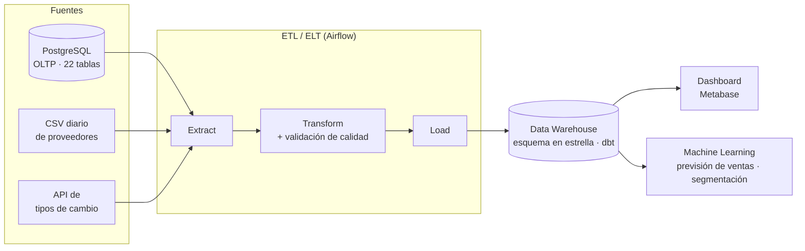
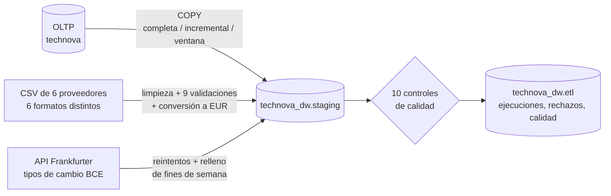

# TechNova Data Platform

Plataforma de datos *end-to-end* para **TechNova**, una cadena ficticia de tecnología **omnicanal** (tienda online + 9 tiendas físicas + 3 almacenes en España).

El proyecto simula todo el ciclo de vida del dato en una empresa real: una base de datos operacional con 3 años de actividad, un flujo **ETL** que integra varias fuentes, un **data warehouse** en estrella, un **dashboard** de negocio y modelos de **Machine Learning**.

> TechNova, sus clientes, empleados y proveedores son ficticios. Todos los datos se generan con Python.

---

## Arquitectura



## Stack

| Área | Tecnología |
|---|---|
| Base de datos | PostgreSQL 17 |
| Infraestructura | Docker · Docker Compose |
| Generación de datos | Python · Faker · psycopg 3 |
| ETL | Python · pandas · requests · API REST |
| Orquestación | Apache Airflow *(Fase 4)* |
| Transformación | dbt *(Fase 5)* |
| Visualización | Metabase *(Fase 6)* |
| Machine Learning | scikit-learn *(Fase 7)* |

---

## Modelo de datos (OLTP)

22 tablas en el esquema `oltp`, agrupadas en 7 áreas:

| Área | Tablas |
|---|---|
| Clientes | `cliente`, `direccion`, `nivel_fidelidad`, `ciudad` |
| Catálogo | `producto`, `categoria` (jerárquica), `marca` |
| Ubicaciones | `ubicacion` (tiendas y almacenes), `stock`, `empleado` (jerárquica) |
| Compras | `proveedor`, `pedido_compra`, `linea_compra` |
| Ventas | `pedido`, `linea_pedido`, `pago`, `envio` |
| Postventa | `devolucion`, `garantia` |
| Marketing | `promocion`, `promocion_producto`, `cupon` |

**Decisiones de diseño destacadas**

- **Precio histórico**: `linea_pedido.precio_unitario` guarda el precio del momento de la venta, independiente del precio actual del producto.
- **Reglas de negocio en la base de datos** mediante `CHECK`: una venta en tienda exige tienda y empleado; una venta web no puede tener empleado; el precio de venta nunca es inferior al coste…
- **Auto-relaciones** para la jerarquía de categorías y el organigrama de empleados.
- **Tiendas y almacenes en una sola tabla** `ubicacion` para que stock, empleados y compras apunten a una única entidad.
- **`NUMERIC`** para importes (nunca `FLOAT`) y claves `GENERATED ALWAYS AS IDENTITY`.

---

## Generador de datos

Simulación **reproducible** (semilla fija) de 3 años de actividad (2023-2025), día a día:

| Dato | Volumen aprox. |
|---|---|
| Clientes / direcciones | 5.000 / 6.200 |
| Productos | 376 (20 marcas, 17 subcategorías) |
| Pedidos / líneas | 18.800 / 28.500 |
| Devoluciones / garantías | 1.400 / 100 |
| Pedidos a proveedores | 560 |

**Comportamientos realistas simulados**

- Crecimiento del negocio ligado al número de clientes registrados
- Estacionalidad: Black Friday, Cyber Monday, Navidad, rebajas, *Días sin IVA*, agosto flojo
- Tiendas cerradas en domingo y festivos; el canal web pasa del 45 % al 60 %
- Regla 80/20 en clientes (distribución de Pareto)
- Descuentos por promoción, cupón de bienvenida y nivel de fidelidad
- Pagos rechazados, pedidos cancelados y reembolsos
- Envíos desde el almacén más cercano, con retrasos en campañas y a Baleares
- Devoluciones dentro del plazo legal de 14 días (30 si es defectuoso) y garantía de 3 años
- Reposición mensual de stock con previsión, stock de seguridad y proveedores en USD, JPY y GBP

---

## SQL avanzado y optimización

### Índices

PostgreSQL crea índices para `PRIMARY KEY` y `UNIQUE`, pero no para las claves foráneas. `sql/init/02_indices.sql` define 28 índices:

| Tipo | Ejemplo | Para qué |
|---|---|---|
| Clave foránea | `idx_pedido_cliente` | JOIN y búsquedas por FK sin recorrer la tabla |
| Compuesto | `idx_pedido_cliente_fecha (id_cliente, fecha DESC)` | Filtro y `ORDER BY` resueltos con un solo índice |
| Parcial | `idx_devolucion_pendiente ... WHERE estado = 'solicitada'` | Índice diminuto para la cola de trabajo de atención al cliente |
| De expresión | `idx_cliente_email_lower (LOWER(email))` | Login sin distinguir mayúsculas |

Los índices redundantes se evitan aplicando la regla del prefijo izquierdo: si una PK o UNIQUE compuesta ya empieza por una FK, no se crea otro índice para ella.

### Benchmark

`benchmarks/benchmark_indices.py` mide 8 consultas típicas con y sin índices usando `EXPLAIN ANALYZE`. Los índices se eliminan dentro de una transacción que después se deshace, así que la base de datos no se modifica.

| Consulta | Sin índices | Con índices | Mejora |
|---|---:|---:|---:|
| Último pedido de cada cliente (subconsulta correlacionada) | 2.815 ms | 8,5 ms | x330 |
| Login por email (sin mayúsculas) | 1,69 ms | 0,01 ms | x113 |
| Líneas vendidas de un producto | 1,38 ms | 0,01 ms | x115 |
| Pagos de un pedido | 0,88 ms | 0,01 ms | x80 |

Resultados completos en [`docs/benchmark_indices.md`](docs/benchmark_indices.md).

### Capa de reporting

Esquema `reporting` (`sql/init/03_reporting.sql`) con vistas pensadas para análisis:

| Objeto | Tipo | Contenido |
|---|---|---|
| `v_lineas_venta` | Vista | Una fila por línea vendida con producto, categoría, marca, importes, margen y devoluciones |
| `v_ventas_mensuales` | Vista | KPIs por mes y canal: pedidos, facturación neta, margen, ticket medio |
| `v_alertas_stock` | Vista | Productos por debajo del stock mínimo, clasificados en ROTURA / CRÍTICO / BAJO |
| `mv_clientes_rfm` | Vista materializada | Segmentación RFM (Recency, Frequency, Monetary) con `NTILE` y 6 segmentos de cliente |

### Consultas de análisis

20 consultas de negocio en `sql/analisis/`, comentadas paso a paso:

| Fichero | Técnicas | Preguntas de negocio |
|---|---|---|
| `01_ventas.sql` | `LAG`, `SUM OVER`, medias móviles, `ROW_NUMBER`, `FILTER` | Crecimiento mes a mes y año a año, acumulado anual, top productos por categoría, rentabilidad del Black Friday, análisis de Pareto |
| `02_clientes.sql` | `NTILE`, cohortes, `PERCENTILE_CONT`, `LAG` por cliente | Regla 80/20, retención por cohortes, frecuencia de compra, clientes en riesgo |
| `03_operaciones.sql` | `RANK`, CTE recursiva, conversión de divisas | Ranking de vendedores, P90 de tiempos de entrega, tasa de devolución, gasto en proveedores en euros, organigrama |

### Hallazgos destacados

- **El Black Friday multiplica por 5 la facturación semanal, pero el margen cae del 20 % al 7 %.** Gana volumen y clientes nuevos a costa de rentabilidad.
- **El 20 % de los clientes genera el 65 % de la facturación** y el 10 % de mejores clientes, casi la mitad.
- **El 33 % del catálogo genera el 80 % de la facturación.**
- **En la web se devuelve más del doble que en tienda** (6,7 % frente a 3 % de las líneas).
- Un cliente tarda una mediana de 34 días en volver a comprar.

---

## ETL multi-fuente

`etl/` integra tres fuentes en una base de datos analítica separada (`technova_dw`), para que los informes nunca ralenticen la base de datos de la tienda.



### Fuentes

| Fuente | Patrón | Detalles |
|---|---|---|
| OLTP (22 tablas) | ELT | `COPY` entre bases de datos. Tres estrategias de carga según la tabla (ver abajo) |
| API de tipos de cambio | ETL | Frankfurter v2 (datos oficiales del BCE). Carga incremental, reintentos con espera exponencial y gestión del `503 Retry-After`. Fines de semana y festivos se rellenan con el último valor publicado y se marcan como interpolados |
| CSV diarios de proveedores | ETL | Cada proveedor usa su propio separador, formato decimal, formato de fecha, codificación y nombres de columna. Un **contrato de datos** por proveedor los traduce al formato común |

### Estrategias de carga de la OLTP

| Estrategia | Cómo funciona | Tablas |
|---|---|---|
| Completa | `TRUNCATE` + `COPY` | Maestros, clientes, stock, envíos, compras |
| Incremental | Solo filas con id mayor que la marca de agua | `linea_pedido`, `pago` (solo se insertan, nunca se modifican) |
| Ventana | Filas de los últimos N días respecto a la marca de agua, con `UPSERT` | `pedido` (30 días), `devolucion` (60), `garantia` (120): sus filas recientes cambian de estado |

### Validación de los ficheros de proveedores

Los CSV se leen siempre como texto y cada fila se valida. Las filas rechazadas se guardan en `etl.rechazo` con el motivo y la fila original.

| Problema | Tratamiento |
|---|---|
| SKU en minúsculas o con espacios | Se corrige |
| SKU vacío o que no existe en el catálogo | Se rechaza |
| Precio vacío, con texto, negativo o cero | Se rechaza |
| Precio anómalo (fuera de 0,5x - 2x del coste conocido, p. ej. errores de tecleo x100) | Se rechaza |
| Stock vacío o negativo | Se rechaza |
| Fecha imposible o moneda distinta a la del contrato | Se rechaza |
| Sin tipo de cambio para esa fecha | Se rechaza |
| SKU duplicado en el fichero | Se conserva la última aparición |
| Más del 25 % de filas con errores | **Se descarta el fichero entero** (cortacircuitos) |

Cada fichero se registra con su hash SHA-256: no se procesa dos veces, pero si el proveedor reenvía una versión corregida con el mismo nombre, se detecta y se vuelve a cargar. Cada fichero se procesa en su propio `SAVEPOINT`, así que un fichero que falla no afecta a los demás.

### Controles de calidad

Tras la carga se ejecutan 10 controles. Los de severidad `error` hacen fallar la ejecución (código de salida 1), para que lo que va después no trabaje con datos incorrectos.

| Control | Severidad |
|---|---|
| Integridad referencial (líneas y pagos sin pedido) | error |
| Importes negativos o descuentos mayores que el importe | error |
| Stock negativo | error |
| Huecos en el calendario de tipos de cambio | error |
| Reconciliación de conteos OLTP / staging | error |
| Pedidos sin líneas | aviso |
| Tipos de cambio desactualizados | aviso |
| Proveedores sin tarifa del día | aviso |
| Tarifas que se desvían más de un 30 % del coste | aviso |

### Trazabilidad

| Tabla | Contenido |
|---|---|
| `etl.ejecucion` / `etl.paso` | Cada ejecución y cada paso: estado, duración, filas leídas, cargadas y rechazadas |
| `etl.watermark` | Hasta dónde se cargó cada tabla incremental |
| `etl.rechazo` | Cada fila rechazada con su motivo y los datos originales |
| `etl.fichero_procesado` | Ficheros procesados con su hash y su resultado |
| `etl.control_calidad` | Resultado de cada control en cada ejecución |

---

## Puesta en marcha

**Requisitos:** Docker Desktop y Python 3.10+

```bash
# 1. Clonar y configurar
git clone https://github.com/TU_USUARIO/technova-data-platform.git
cd technova-data-platform
cp .env.example .env            # y edita las contraseñas

# 2. Levantar PostgreSQL + pgAdmin (crea las 22 tablas automáticamente)
docker compose up -d

# 3. Generar los datos
python -m venv .venv
source .venv/bin/activate       # Windows: .venv\Scripts\activate
pip install -r requirements.txt
python data_generator/main.py

# 4. (Opcional) Medir el efecto de los índices
python benchmarks/benchmark_indices.py

# 5. Simular los ficheros de los proveedores y lanzar el ETL
python etl/simular_proveedores.py --desde 2025-12-01 --hasta 2025-12-31
python etl/run_etl.py --fecha 2025-12-31
```

| Servicio | URL |
|---|---|
| PostgreSQL | `localhost:5432` |
| pgAdmin | http://localhost:5050 |

---

## Estructura

```
technova-data-platform/
├── docker-compose.yml
├── requirements.txt
├── sql/
│   ├── init/                   # se ejecutan solos al crear la base de datos OLTP
│   │   ├── 01_schema.sql       # esquema OLTP (22 tablas)
│   │   ├── 02_indices.sql      # 28 índices
│   │   └── 03_reporting.sql    # vistas de negocio y RFM
│   ├── analisis/               # consultas de análisis
│   │   ├── 01_ventas.sql
│   │   ├── 02_clientes.sql
│   │   └── 03_operaciones.sql
│   └── dw/
│       └── 01_dw_schema.sql    # esquemas staging y etl del DW
├── data_generator/             # simulación de datos
│   ├── main.py                 # ejecuta todo en orden
│   ├── config.py               # parámetros de la simulación
│   ├── db.py                   # conexión reutilizable
│   ├── seed_maestros.py
│   ├── seed_entidades.py
│   ├── seed_ventas.py
│   ├── seed_postventa.py
│   └── seed_inventario.py
├── etl/
│   ├── run_etl.py              # orquesta los pasos del ETL
│   ├── configuracion.py        # estrategias de carga, contratos de proveedor, umbrales
│   ├── conexiones.py           # OLTP y DW
│   ├── registro.py             # logs y trazabilidad en etl.*
│   ├── extraer_oltp.py         # OLTP -> staging
│   ├── divisas.py              # API -> staging
│   ├── proveedores.py          # CSV -> staging
│   ├── calidad.py              # controles de calidad
│   └── simular_proveedores.py  # genera los CSV (simula el exterior)
├── benchmarks/
│   └── benchmark_indices.py
├── dbt/                        # Fase 5
├── data/                       # ficheros de proveedores (no se sube a Git)
├── logs/                       # logs del ETL (no se sube a Git)
└── docs/
    └── benchmark_indices.md
```

---

## Roadmap

- [x] **Fase 1** — Modelo de datos y PostgreSQL en Docker
- [x] **Fase 2** — Generador de datos realistas
- [x] **Fase 3** — SQL avanzado, índices y optimización
- [x] **Fase 4a** — ETL multi-fuente con validación y controles de calidad
- [ ] **Fase 4b** — Orquestación con Airflow
- [ ] **Fase 5** — Data warehouse en estrella con dbt
- [ ] **Fase 6** — Dashboard de negocio
- [ ] **Fase 7** — Machine Learning